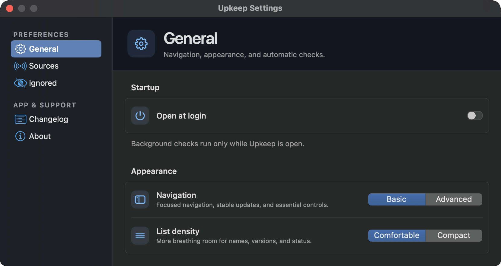

# Upkeep

[](https://github.com/dyd4dsh7/UpKeep/actions/workflows/ci.yml)
[](LICENSE)

A native macOS app for keeping applications and developer tools up to date.



## Install and support

Requires **macOS 14 or newer**. Official download builds target **Apple Silicon**.
Intel source builds are not currently covered by CI. Download signed, notarized
archives only from [GitHub Releases](https://github.com/dyd4dsh7/UpKeep/releases).
If no release is listed, use the source-build instructions below; a successful
CI run or a debug ZIP is not a notarized release.

For a published release, download `Upkeep.zip` and `Upkeep.zip.sha256`, run
`shasum -a 256 -c Upkeep.zip.sha256` in the download directory, extract the ZIP,
and move `Upkeep.app` into Applications. Open it normally through Finder.
Do not disable Gatekeeper to run an unverified download.

Homebrew and other managers are optional. Upkeep uses tools already installed on
your Mac. Start with application management and enable developer or model checks
when you need them.


Upkeep is a native SwiftUI macOS application that scans installed apps and checks publisher and package-manager update sources. First-run setup starts with focused application management; Homebrew and the broader developer environment are explicit opt-ins.

The app includes a standard unified macOS toolbar with a prominent live update counter, a menu-bar status item, and a Dock icon badge using the same focused count. The primary count covers application updates, requested Homebrew packages, and macOS updates; global developer packages and Homebrew dependencies remain available in their dedicated workspaces without overwhelming the main queue. It also provides native Settings for every source and supported developer manager, configurable launch/background checks, beta visibility, and notifications.

Individual app, package, and local-model releases can be skipped without hiding later versions, or ignored until restored from Settings. Skipped and ignored updates are excluded from the update list, sidebar badge, menu-bar count, and notifications. Batch review groups recommended updates separately from manual actions, major releases, prereleases, dependencies, and developer-environment changes; only stable updates Upkeep can complete directly are selected by default.

## Update sources

- Mac App Store metadata for production App Store installations
- Sparkle appcast feeds declared by applications or their runtime preferences
- Homebrew casks, when Homebrew is installed
- GitHub Releases discovered from app and Electron update metadata, trusted bundle mappings, or a user-verified repository
- Ollama registry manifests and LM Studio model repositories for locally installed AI models

TestFlight, Setapp, Microsoft AutoUpdate, Steam, Adobe Creative Cloud, JetBrains Toolbox, Epic Games, Spotify, Discord, standalone Tailscale, and macOS-managed apps are identified separately and routed to their owning updater. Steam download progress is read from local manifests. Sparkle appcasts that declare a package installer open the app's built-in updater instead of presenting the package as a normal download action.

Apps with an embedded updater remain labeled as built-in-updater apps even when
their publisher configures the release feed at runtime. Advanced app details can
attach an `owner/project` GitHub repository; Upkeep validates that it has
published releases before saving the bundle-specific mapping. External update
actions remain pending until the installed bundle reports the expected version.

## Apple Silicon migration

On Apple Silicon Macs, Intel-only apps show a warning in application lists and details. **Move to Apple Silicon** opens a guide to the existing update manager, Homebrew cask, or developer releases. Installation is completed through that source; Upkeep does not assume that a native download exists or automatically replace the app. **Verify Installed App** rereads the original app location and confirms ARM support, including Universal builds and same-version replacements. Missing or unreadable executables remain unverified. Detection describes the main executable, not every embedded helper or the architecture of an already-running process.

## Homebrew workspace

Upkeep inventories installed formulae and casks, separates requested packages from dependencies, filters available updates, and exposes package details. Apps matched against Homebrew's official cask catalog can be adopted with Homebrew's native `--adopt` workflow.

## macOS and recovery

The macOS section reads Apple's Software Update catalog, lists compatible full installers, and opens Apple's authenticated settings for stable or beta-channel enrollment and installation. Before supported GUI app updates, Upkeep creates a local backup and adds a History entry that can restore the previous app bundle. It retains the three newest backups per app and twenty backups overall, removes a newly created backup when its update fails, and marks older history entries when their backup has expired. Formula and macOS recovery entries explain the supported Time Machine, versioned-formula, or macOS Recovery path when direct rollback is not available.

## Developer packages

Upkeep inventories globally installed npm, pnpm, Python/pip, RubyGems, and Cargo packages when their package managers are available. Manager filters only appear for installed tools, and packages without updates remain visible with a Current status. It preserves the discovered executable path—such as an NVM Node installation—when applying an update. Apps not currently managed by Homebrew also contribute to the update count when Homebrew's official cask catalog has a newer version; Upkeep backs up the app before replacing it and enrolling it under Homebrew management.

Package rows use native system symbols and open detailed metadata when selected. npm, pnpm, pip, RubyGems, and Cargo packages can be installed at an explicit published version. Homebrew version selection follows its versioned-formula model; historical cask releases are only available when the cask itself exposes them.

Developer package details load available releases from the package manager or registry into a version menu and select the latest release by default. The Developer toolbar can refresh all installed managers or only npm, pnpm, Python, RubyGems, or Cargo.

The Homebrew and Developer toolbars also expose supported cleanup operations for Homebrew, npm, pnpm, and uv. Upkeep first performs a non-destructive check, shows Homebrew's dry-run estimate or clearly labels when a manager cannot predict its cleanup size, and asks for confirmation before cleaning. It then reports the disk space reclaimed.

## CVE checker

Refresh the app and package inventories, then open **CVE Checker** in the System sidebar and choose **Check CVEs**. Checks run automatically after launch and scheduled inventory refreshes when **Automatically check CVEs** is enabled in Settings (on by default), as well as after manual inventory refreshes. The existing launch and background schedule controls determine those automatic refresh times. You can also run a check manually. Coverage includes:

- Developer packages through [OSV](https://osv.dev), using registry identities and installed versions.
- Homebrew core formulae through [Homebrew's advisory feed](https://formulae.brew.sh/api/advisories.json), comparing installed versions including `_N` revisions. The feed has limited coverage; third-party taps, nonzero version schemes, and unsupported version formats are labeled not covered.
- Installed apps and official Homebrew casks through [NVD](https://nvd.nist.gov/developers/vulnerabilities), using curated product mappings and installed versions. Initial mappings cover stable Chrome, Firefox, Thunderbird, Safari, VLC, and Visual Studio Code; Safari is matched through its app bundle. Unknown identities and prerelease versions remain not covered. NVD matches are potential CVEs whose platform and configuration applicability should be reviewed in the linked record. Cask results use Homebrew's receipt version, which can lag an app's own updater.

The overview summarizes findings, completed checks, incomplete checks, and uncovered software. Filter by result type or search for software and CVE identifiers. Select software in the compact list to review advisories, severity, fixed releases, source links and update actions in a separate detail pane. The list and details scroll independently. Records that share CVE/GHSA aliases are grouped as one issue while preserving their source links. The Homebrew advisory index downloads once per check; duplicate NVD product/version queries share results within that check. NVD requests are paced at least 6.1 seconds apart across windows. Unavailable, rate-limited, or partially retrieved sources produce incomplete checks. No API key is required.

CVE advisory details show the highest available source severity (CVSS base scores where supported) and explicit fixed releases for the matched package. Missing ratings are marked Unrated; missing fix metadata is not treated as proof that no fix exists. Fix lists may span multiple release branches. NVD affected-range boundaries are not presented as verified fixes. Update All opens a review limited to affected software with current update offers, with all items selected, including developer packages in Basic mode. It ignores checker search/filter state, deduplicates app/cask actions, and revalidates reviewed offers before execution. Existing batch progress, app-quit review, Homebrew authorization notice and per-item results are retained. External updater actions still require completion in the source app. An Update button appears when current inventory offers an update for the affected installed version, preserving the existing update confirmations and progress. External update sources retain their normal Open App Store, View Release, or similar action. Excluded updates and changed installed versions are not offered from an old CVE result. Review Updates and Show Software open the existing inventory/update workflows; advisory links provide publisher guidance before choosing an update.

Results and running checks are shared across the app session. Applications and Updates rows show a CVE badge only when advisories are found for the installed version; click a badge to open its results. Pending, failed, uncovered, and empty checks remain visible in the CVE Checker. Changed identities or installed versions, and results older than 24 hours, need a new check. A badge does not claim that the available update fixes the advisory. Checks do not install updates or scan project lockfiles, embedded libraries, unlisted transitive dependencies, or macOS itself. An empty result means the selected source returned no known advisories for that identity/version, not that the software is guaranteed safe.

## Local AI models

Upkeep detects locally installed Ollama and LM Studio models without showing empty runtime sections. Ollama models are checked by comparing their local and registry manifest digests. LM Studio model files are checked against their originating Hugging Face repository. Supported updates run through `ollama pull` or `lms get`, so credentials, storage, and model management remain with the installed runtime.

The model workspace uses native system symbols to identify model runtimes.

## Changelog

Upkeep includes its native changelog inside Settings. The complete release history is also maintained in [CHANGELOG.md](CHANGELOG.md).

Upkeep never downloads executables from its own servers. App Store updates open in the App Store, Sparkle downloads come from the app's declared developer feed, and Homebrew apps are upgraded through the local Homebrew installation.

## Build

Use **Xcode 26.3 or newer**, or matching Apple Command Line Tools, with the
**macOS 26 SDK or newer**. CI explicitly selects Xcode 26.3. The build SDK is newer
than the macOS 14 deployment target because the source uses newer SwiftUI APIs
behind availability checks. A complete stable toolchain is recommended; beta
Command Line Tools may omit SwiftUI macro plugins.
If tests fail to link `_TestingInterop`, select a full Xcode installation;
changing only the SDK does not supply that test runtime library.

No Apple Developer membership or signing secrets are needed for local debug builds.
Clone this repository, then:

```sh
swift test -Xswiftc -warnings-as-errors
./script/build_and_run.sh
```

## Performance

For repeatable, offline performance measurements, run
`./scripts/benchmark-performance.sh outputs/performance/current.log`.
The benchmark uses an optimized build and isolated fixtures; it does not run
package managers or apply updates. See the [performance report](docs/performance/2026-08-31.md)
for baseline measurements, results, tradeoffs, and comparison commands.
The [second performance pass](docs/performance/2026-08-31-services.md) covers
diagnostics loading/redaction and developer release sorting. Run it with
`./scripts/benchmark-performance.sh outputs/performance/services.log services`.
The [third performance pass](docs/performance/2026-08-31-search.md) covers global
search across all seven result groups. Run it with
`./scripts/benchmark-performance.sh outputs/performance/search.log search`.

## Privacy and permissions

Update checks contact publishers and registries for the sources you enable.
Preferences, diagnostics, history, and backups stay on your Mac; Upkeep has no
Upkeep-operated analytics endpoint. See [PRIVACY.md](PRIVACY.md) for the data read,
network requests, retention, and export behaviour.

macOS may request App Management access, notifications, or authentication for a
specific action. Review updates and cleanup before confirming them. App backups
are limited and do not replace a system backup.

## Limitations

- Some apps can only update through their publisher's own updater or the App Store.
- Unavailable, blocked, or rate-limited sources may leave an update check incomplete.
- Package-manager changes can affect your development environment; arbitrary package
  downgrades and automatic system rollback are not supported.
- Apple Silicon migration verifies the main executable, not every helper or plugin.
- macOS 14 is the deployment target; the current CI smoke test runs on macOS 26.
  This is not evidence of an end-to-end test on every supported macOS version.

## Contributing and security

See [CONTRIBUTING.md](CONTRIBUTING.md) for setup, project structure, and PR guidance.
Use [GitHub Issues](https://github.com/dyd4dsh7/UpKeep/issues) for bugs and proposals.
Report vulnerabilities privately using [SECURITY.md](SECURITY.md).

## Licence

Upkeep's original code and artwork are licensed under [MIT](LICENSE).
[Third-party notices](THIRD_PARTY_NOTICES.md) describe dependency licences, system
resources, and trademarks. Third-party names do not imply endorsement.

## Maintainer releases

See [the release guide](docs/releasing.md) for protected signing credentials,
notarization, version tags, draft releases, and distribution verification.
The app declares its canonical GitHub repository to discover published releases.
