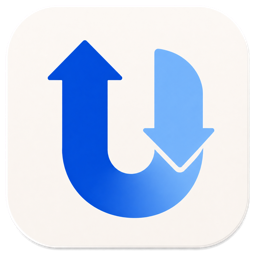
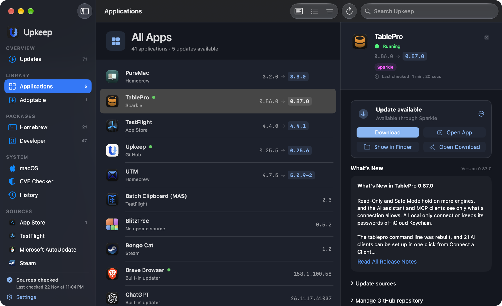

<div align="center">

<picture>
  <source media="(prefers-color-scheme: dark)" srcset="docs/images/icon-dark.png">
  
</picture>

# Upkeep

**Keep your Mac's apps, packages, and developer tools up to date, and tidy, from one native app.**

[](https://github.com/dyd4dsh7/UpKeep/releases/latest)
[](https://github.com/dyd4dsh7/UpKeep/actions/workflows/tests.yml)


[](LICENSE)

[Download](https://github.com/dyd4dsh7/UpKeep/releases/latest) ·
[Changelog](CHANGELOG.md) ·
[Privacy](PRIVACY.md) ·
[Report a bug](https://github.com/dyd4dsh7/UpKeep/issues)



</div>

## Why Upkeep

- **One list for everything.** Apps, Homebrew, macOS, packages from 42 developer
  tools (npm, pip, Cargo, Go, Docker, Conda, and more), and local AI models share one
  **All Updates** view, with a live count in the toolbar, menu bar, and Dock.
- **Uses what you already have.** Upkeep works through the tools installed on your
  Mac. Homebrew and developer checks are opt-in.
- **Updates from the real source.** App Store updates open in the App Store (or
  install with [`mas`](https://github.com/mas-cli/mas) when you have it), Sparkle
  downloads come from the developer's own feed, and Homebrew upgrades run through
  your local Homebrew. Upkeep has no download servers of its own.
- **Knows what everything is.** Each app, package, and model shows a one-line
  description, and packages show the release notes for the version on offer.
- **Tidy up as well as update.** Uninstall apps, Homebrew packages, developer
  packages, and AI models, optionally with an app's leftover data, and find tools
  and runtimes installed more than once.
- **Safe by default.** App updates are backed up first, and uninstalled apps go
  to the Trash; History can restore both. Batch review only preselects stable
  updates Upkeep can finish itself, and automatic updates are off until you turn
  them on.
- **Security checks built in.** The CVE Checker flags known advisories for
  installed apps and packages.

## Install

Requires **macOS 14 or newer** on **Apple Silicon**. Intel source builds are not
currently tested.

1. Download `Upkeep.zip` and `Upkeep.zip.sha256` from
   [GitHub Releases](https://github.com/dyd4dsh7/UpKeep/releases/latest). Only download builds from there.
2. In the download folder, run:
   ```sh
   shasum -a 256 -c Upkeep.zip.sha256
   ```
3. Extract the ZIP and move `Upkeep.app` to Applications.

> [!IMPORTANT]
> Current releases are signed locally and **not notarized** by Apple, so macOS
> blocks the first launch. After the checksum passes, Control-click `Upkeep.app`,
> choose **Open**, and confirm. You can also use **Open Anyway** in
> System Settings › Privacy & Security. Do not turn off Gatekeeper.
> Each release says whether its build is notarized.

From 0.25.5, Upkeep updates itself: **Upkeep › Check for Upkeep Updates…**
verifies the release's checksum and Ed25519 signature before installing in place.
If a release has no build attached, [build from source](#build-from-source).

## What Upkeep checks

| Source | How Upkeep checks |
| --- | --- |
| **Mac App Store** | App Store metadata for production installs, including iPhone and iPad apps on Apple silicon |
| **Sparkle** | Appcast feeds declared by the app, its runtime preferences, or a trusted mapping |
| **Publisher version services** | Chrome, Edge, Firefox, Thunderbird, Brave, standalone JetBrains IDEs, Zoom, Slack, and 1Password |
| **Electron update servers** | The release manifest (such as `latest-mac.yml`) of apps that use electron-updater's generic provider |
| **Homebrew** | Installed formulae and casks, including dependencies |
| **GitHub Releases** | Repos found in app or Electron update metadata, trusted mappings, or a repo you verify. Uses your GitHub CLI sign-in when there is one, to avoid GitHub's hourly limit |
| **macOS** | Apple's Software Update catalog (macOS, Safari, and Command Line Tools for Xcode) and full installers |
| **Developer packages** | Global packages from 42 managers, including npm, pnpm, Yarn, Bun, pip, uv, Conda, RubyGems, Cargo, Go, and Docker images |
| **Local AI models** | Ollama registry manifests, LM Studio's Hugging Face repos, and the Hugging Face cache |

Apps with their own updater are recognised and handed to it: TestFlight, Setapp,
Microsoft AutoUpdate, Steam, Adobe Creative Cloud, JetBrains Toolbox, Epic Games,
Spotify, Discord, standalone Tailscale, and macOS-managed apps, including Apple's
utilities such as Feedback Assistant.

Microsoft Office and Teams are also checked for updates: Upkeep reads the app ID
and channel (such as Beta or Preview) that Microsoft AutoUpdate records for each
app, compares the installed build with Microsoft's published manifest for that
channel, and opens AutoUpdate to install. It does not run `msupdate`, which can
start downloads.

## Features

### Update review

Skip one release without hiding later ones, or ignore an update until you restore
it in Settings. Skipped and ignored updates are left out of every count and
notification. Batch review separates recommended updates from manual actions,
major releases, prereleases, dependencies, and developer-environment changes.

<details>
<summary>More about update sources</summary>

- A Homebrew cask that matches an installed app appears once, as the app update.
- iPhone and iPad apps installed from the App Store on Apple silicon are listed
  with your Mac apps. Their updates open in the App Store. iPhone and iPad apps
  installed another way have no update source.
- Sparkle appcasts that declare a package installer open the app's built-in
  updater instead of downloading the package.
- Apps with an embedded updater stay labelled as such even when the publisher sets
  the feed at runtime. Some of these, such as ChatGPT, are checked through the
  feed packaged in the app.
- Publisher version services and Electron update servers only report the newest
  release; the app's built-in updater installs it. Electron prereleases are hidden
  from stable installs unless you include prereleases, and staged rollouts are
  shown once they reach everyone.
- JetBrains IDEs and Zoom are compared by build number, so patch releases with
  the same marketing version are found.
- In advanced app details you can attach an `owner/project` GitHub repo. Upkeep
  checks it has published releases before saving the mapping.
- External update actions stay pending until the installed app reports the
  expected version. Steam download progress is read from local manifests.
- Settings cover every source and developer manager, launch and background
  checks, beta visibility, and notifications.
- "Upkeep found updates" notifications have **Review** and **Update
  Recommended** buttons. Update Recommended opens the review instead when an
  update would quit a running app or ask for a password.
- When the [`mas`](https://github.com/mas-cli/mas) command-line tool is
  installed, App Store updates install with `sudo mas update` in Terminal, which
  asks for your password, instead of opening the App Store.
- GitHub allows 60 API requests an hour without signing in. When the GitHub CLI
  is signed in, Upkeep uses that sign-in for `api.github.com` only, raising the
  limit to 5,000. If the limit is reached, GitHub checks pause until it resets
  instead of failing one by one.

</details>

### Automatic updates

**Automatic updates** in Settings › General is off by default. It can install
Homebrew formulae only, or all recommended updates (stable, non-major versions
Upkeep can finish itself), after each scheduled check. Running apps, Homebrew
casks (which may ask for a password), and major versions always wait for you.
Nothing installs while the Mac is on battery, in Low Power Mode, offline, or on a
metered or Low Data Mode network; Upkeep tries again every 30 minutes.

### What's new and what it is

Lists and details panels show a one-line description of each app, package, and
model, from its package registry, the App Store, Homebrew, Steam, or Hugging
Face, or from Upkeep's own descriptions of runtimes, Apple apps, and common model
families. Homebrew and developer packages also show **What's New**: the GitHub
release notes for the version being offered, found through the package's
registry metadata or homepage.

### Backups and recovery

Before a supported app update, Upkeep backs up the app and adds a History entry
that can restore it. It keeps the 3 newest backups per app and 20 overall, and
deletes a new backup if its update fails. For formulae and macOS, History explains
the Time Machine, versioned-formula, or macOS Recovery route instead.

History also records uninstalls. Anything Upkeep moved to the Trash has a **Put
Back** button that returns it, and any app data removed with it, to where it was.
Homebrew and package-manager uninstalls show the command that was run.

### Uninstall

Apps, Homebrew formulae and casks, developer packages, and local AI models can be
uninstalled from their details panel, options menu, or context menu:

- **Apps** move to the Trash after a running app is quit. Apps installed with a
  Homebrew cask use `brew uninstall --cask`. Administrator-owned apps, such as App
  Store apps, are moved by Finder, which asks for your password. Apps macOS
  protects, such as Safari, can't be removed.
- **App data:** the confirmation can also move the app's settings and caches in
  `~/Library` to the Trash. Folders are found by the app's bundle identifier, or
  by its exact name when no other app shares it; Apple apps and apps with more
  than one copy installed are left alone, and the dialog lists which folders it
  found.
- **Packages and models** use their own tool (`brew uninstall`, `npm uninstall
  -g`, `ollama rm`, and so on), or move a self-contained install such as Bun or
  Deno to the Trash. Remove any lines a tool added to your shell profile yourself.

### Duplicates

**Duplicates** in the Library sidebar lists apps installed in more than one place,
command-line tools installed more than once (for example the same npm package
under Homebrew's npm and under nvm), tools managed by two installers, and runtimes
with several versions installed.

- The copy in use is marked: for tools, the one that runs first on the `PATH`
  your Terminal uses (including folders nvm and similar tools add); for apps, the
  copy macOS opens by default.
- **Keep** keeps one copy and removes the others with the normal uninstall steps,
  so every removal is recorded in History. The copy in use, or else the newest, is
  the recommended one. Runtime versions are removed one at a time instead.
- With nvm, each Node.js version has its own global packages, so a copy only runs
  while its version is active. For JavaScript tools that Homebrew also packages,
  such as pnpm, **Use Homebrew Instead** installs the tool once for every Node.js
  version and then removes the copies; nothing is removed if the install fails.
- **Not a Duplicate** hides a group; **Show Hidden Groups** brings it back.
- npm and corepack bundled with each Node.js, Python and Ruby packages (each
  environment needs its own), and Upkeep itself are never listed.

### Homebrew

Browse installed formulae and casks, with requested packages separated from
dependencies. **Pin Version** runs `brew pin`, so a formula stays at its installed
version: it counts as up to date and automatic updates skip it until you unpin it. Apps that match Homebrew's official cask catalog can be adopted with
Homebrew's `--adopt` workflow. Apps not managed by Homebrew also count as updates
when the catalog has a newer version; Upkeep backs the app up before handing it
to Homebrew.

Homebrew normally reports casks that update themselves (`auto_updates`) as
current, and its recorded version goes stale once the app updates. Upkeep
compares those casks with the version of the app actually installed, so an app
that is behind its cask is reported and one that updated itself is not. A cask
whose app isn't installed keeps Homebrew's answer. Casks are matched to apps by
the app bundles they install as well as by name.

`brew info` never refreshes Homebrew's cached catalog, so before reading your
packages Upkeep runs `brew update --auto-update`, the refresh Homebrew runs
before installs, at most once an hour (or every `HOMEBREW_AUTO_UPDATE_SECS`). It
skips the refresh when `HOMEBREW_NO_AUTO_UPDATE` is set in the environment or in
a Homebrew `brew.env` file. Nothing is installed or upgraded.

### Developer packages

Upkeep lists global packages for the managers you have installed:

- **JavaScript:** Node.js, nvm itself, Bun, Deno, npm, pnpm, Yarn, Volta, and fnm
- **Python:** Python/pip, pipx, uv, pyenv Python versions, Poetry (official
  installer), Conda base environments, and pixi global packages
- **Ruby and Rust:** RubyGems, rbenv Ruby versions, Rustup, and Cargo
- **Other tools:** Go, Composer, .NET tools, GitHub CLI, and editor extensions for
  VS Code, Cursor, VSCodium, and Windsurf (now Devin Desktop)
- **Language toolchains:** Flutter, Dart global packages, swiftly (Swift),
  juliaup (Julia), GHCup (Haskell), opam (OCaml), and SDKMAN! (Java and JVM tools)
- **Kubernetes and cloud:** Krew kubectl plugins, the Google Cloud CLI, and Azure
  CLI extensions
- **Xcode:** simulator runtimes for the selected Xcode
- **AI tools:** Claude Code installed with its native installer, on the release
  channel set in its settings (npm and Homebrew copies update with those managers)
- **System managers:** MacPorts, Nix, mise, and asdf
- **Containers:** Docker images pulled from a public registry

It keeps the executable path it found (such as an NVM Node install) when
updating, and lets you pick a specific published version. pnpm keeps global
packages in one folder whichever Node.js runs it, so they are listed once.

nvm is checked as a git checkout against its latest GitHub release and updated
with nvm's documented steps, only when the checkout is clean and on a release
tag. Some managers have their own update rules. swiftly toolchains update within
their minor release, GHCup tools are compared with GHCup's recommended version,
SDKMAN! candidates keep their vendor (a Temurin JDK is not offered Zulu), and
opam packages follow your last `opam update`. pyenv and rbenv versions are
grouped by release line (Python 3.12, Ruby 3.4) and offered the newest patch the
tool can install; the new patch is installed beside the old one, which you can
then remove. RubyGems checks the Ruby rbenv or Homebrew provides before macOS's
own. npm is offered the newest release that supports the Node.js beside it. A
simulator runtime is offered an update only when it is a beta or release
candidate for the version the selected Xcode now ships; the update downloads the
matching runtime with `xcodebuild -downloadPlatform`. MacPorts warns when its
ports list has not been refreshed for two weeks, since only `sudo port
selfupdate` can refresh it. Poetry is checked only when the
official installer put it there; Homebrew and pipx copies update with those
managers.

Editor extensions are checked against the gallery each editor installs from, read
from its `product.json`: the Visual Studio Marketplace for VS Code, Open VSX for
VSCodium, and Cursor's and Windsurf's own marketplaces. Their versions differ, so
Upkeep only offers versions the editor can install.

Docker images are compared by content digest and updated with `docker pull`.
Upkeep only lists an image when its registry recognises the local digest, so
local builds are never flagged or overwritten, even when they share a public
image's name. Unqualified names are checked only when they are on Docker's
official image list, so local project names are not sent to Docker Hub.
Upkeep uses HEAD requests, which do not count toward Docker Hub's pull limit.
It doesn't sign in to registries, so private images aren't listed, and a
stopped Docker daemon is skipped quietly.

**Cleanup** for Homebrew, npm, pnpm, and uv starts with a dry run, shows the
estimated size (or says when a manager can't predict it), asks before cleaning,
and reports the space reclaimed.

### CVE Checker

Open **CVE Checker** in the System sidebar and choose **Check CVEs**. Checks also
run after launch, scheduled, and manual refreshes while **Automatically check CVEs**
is on (the default). No API key is needed.

| Software | Advisory source |
| --- | --- |
| Developer packages | [OSV](https://osv.dev) |
| Homebrew core formulae | [Homebrew advisory feed](https://formulae.brew.sh/api/advisories.json) |
| Selected apps and official casks | [NVD](https://nvd.nist.gov/developers/vulnerabilities) |

Apps and updates with known advisories get a CVE badge that links to the results.
**Review Updates…** reviews every affected item that has an update available.

> [!NOTE]
> An empty result means the source returned no known advisories for that version,
> not that the software is safe. A badge does not claim the available update fixes
> the advisory.

<details>
<summary>Coverage and limits</summary>

- NVD mappings currently cover stable Chrome, Firefox, Thunderbird, Safari, VLC,
  and Visual Studio Code. NVD matches are *potential* CVEs; check the linked
  record for platform applicability.
- Homebrew's feed has limited coverage. Third-party taps, unusual version schemes,
  unknown identities, and prereleases are marked **not covered**.
- Cask results use Homebrew's receipt version, which can lag an app's own updater.
- Advisories show the highest available source severity (CVSS where supported) and
  any fixed releases listed for the package. Missing ratings show as **Unrated**;
  missing fix data does not mean no fix exists.
- Records sharing CVE/GHSA aliases are grouped as one issue.
- Unavailable, rate-limited, or partial sources produce an **incomplete** check.
  NVD requests are paced at least 6.1 seconds apart.
- Results are kept for the app session. A changed version, or a result older than
  24 hours, needs a new check.
- Checks never install updates, and do not scan project lockfiles, embedded
  libraries, unlisted transitive dependencies, or macOS itself.

</details>

### Apple Silicon migration

Intel-only apps are flagged on Apple Silicon Macs. **Move to Apple Silicon** points
you to the app's update manager, Homebrew cask, or developer releases; Upkeep does
not assume a native build exists or replace the app itself. **Verify Installed
App** then confirms ARM support, including Universal builds. Only the main
executable is checked, not every helper.

### Local AI models

Upkeep finds installed Ollama and LM Studio models and compares them with their
registry or Hugging Face source. Updates run through `ollama pull` or `lms get`,
so credentials and storage stay with your runtime.

Models in the Hugging Face cache (`~/.cache/huggingface/hub`, or `HF_HUB_CACHE`
and `HF_HOME`), such as MLX models, are compared with their repository's `main`
branch. Updates run `hf download` for the files already cached, so the Hugging
Face CLI must be installed. Models downloaded at a pinned revision are left
alone, and gated or private models can't be checked without signing in.

## Links

`upkeep://` links open a section or start a check, for example from a script or
Shortcuts' **Open URL** action. Links never install or remove anything.

| Link | Opens |
| --- | --- |
| `upkeep://updates` | Updates (also `upkeep://`) |
| `upkeep://applications`, `homebrew`, `developer`, `models`, `macos`, `history`, `duplicates`, `cve`, `adoptable` | That section |
| `upkeep://search?q=firefox` | Search results |
| `upkeep://review` | Update review |
| `upkeep://check` | Starts a full check |

## Privacy and permissions

Update checks contact the publishers and registries for the sources you enable,
and descriptions and release notes are looked up from the same registries and
GitHub. Preferences, diagnostics, history, and backups stay on your Mac, and Upkeep
runs no analytics service of its own. See [PRIVACY.md](PRIVACY.md) for exactly
what is read, sent, and kept.

macOS may ask for App Management access, notifications, permission to control
Terminal (for Homebrew and `mas` commands that need your password) or Finder (to
move administrator-owned apps to the Trash), or authentication for a specific
action. Review updates, uninstalls, and cleanup before confirming them. App
backups are limited and do not replace a system backup.

## Limitations

- Some apps only update through their publisher's updater or the App Store.
- Unavailable, blocked, or rate-limited sources can leave a check incomplete.
- Package-manager changes can affect your development environment. Arbitrary
  downgrades and automatic system rollback are not supported.
- Homebrew historical versions follow its versioned-formula model; old cask
  releases are only available when the cask exposes them.
- macOS 14 is the deployment target, but tests and smoke checks run on macOS 27.
  Not every supported macOS version is tested end to end.

## Build from source

You need **Xcode 26.6+ (Swift 6.3+)** or matching Command Line Tools with the
**macOS 26 SDK or newer**. No Apple Developer account or signing secrets are needed.

```sh
git clone https://github.com/dyd4dsh7/UpKeep.git
cd UpKeep
swift test
./script/build_and_run.sh
```

<details>
<summary>Toolchain notes and benchmarks</summary>

The SDK is newer than the macOS 14 target because newer SwiftUI APIs sit behind
availability checks. Tests use the toolchain's bundled Swift Testing, so no extra
package, backend override, or linker paths are needed. `UpkeepState` selects
SwiftUI's native State property wrapper without the macOS 27 SDK's macro plugin.

For offline performance measurements, run
`./scripts/benchmark-performance.sh outputs/performance/current.log`. It uses an
optimized build and fixtures, and never runs package managers or applies updates.
Add `services` or `search` after the log path to benchmark diagnostics and release
sorting, or global search. The [live scan benchmark](docs/performance/2026-11-22-live-scan.md)
measures a real full scan and the effect of its caches.

</details>

## Contributing and security

- Setup, project layout, and PR guidance: [CONTRIBUTING.md](CONTRIBUTING.md)
- Bugs and proposals: [GitHub Issues](https://github.com/dyd4dsh7/UpKeep/issues)
- Vulnerabilities (report privately): [SECURITY.md](SECURITY.md)
- Maintainer releases: [release guide](docs/releasing.md)

## Licence

Upkeep's original code and artwork are [MIT licensed](LICENSE). Third-party logos
in `Sources/Upkeep/Resources/ThirdPartyLogos/` belong to their owners and are
**not** covered by the MIT licence. See [THIRD_PARTY_NOTICES.md](THIRD_PARTY_NOTICES.md)
for each logo's source and terms. Third-party names and logos do not imply
endorsement.
